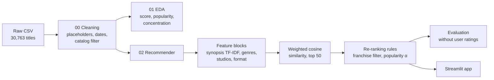
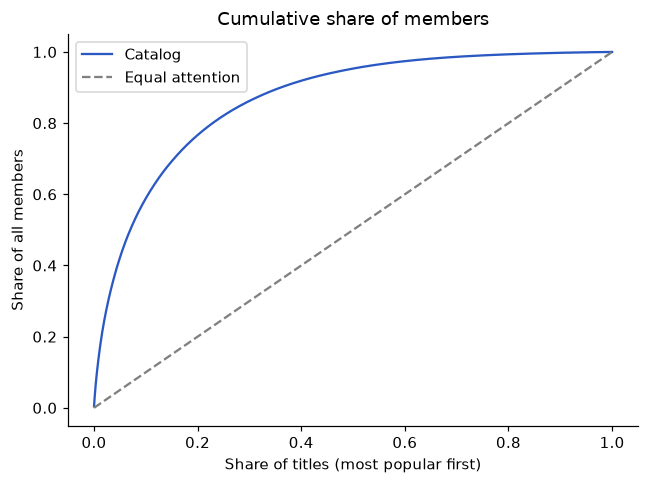

# Anime Recommender

Type an anime you liked and get five shows to watch next.

**Live app:** https://kstnwu-anime-recommender.streamlit.app/

## Summary

- **Problem:** New titles have no viewing history, so "viewers also watched" recommendations can't cover them.
- **Solution:** A recommender that matches anime by story, genre, studio and format, built on 6,737 titles.
- **Key decision:** Sequels made up 24% of raw recommendations, so the model skips titles from the same series.
- **Result:** Recommendations stay on-genre (genre overlap 0.71 vs. 0.10 for "most popular") and reach 90% of the catalog.

## Questions

1. Which aspects of a title (story, genre, studio, format) make a useful "more like this" recommendation?
2. How do you choose between recommenders when there are no user ratings to measure accuracy?

## Data

[Anime Dataset 2026](https://www.kaggle.com/datasets/darkbarrierhub/anime-dataset-2026) (Kaggle, from MyAnimeList): 30,763 titles with synopsis, genres, studio, score and member counts. No user-level ratings.

After filtering to rated TV series, movies and ONAs and removing adult titles, 6,737 titles remain.

## Approach



**Features.** Each title is described by four feature groups, combined with fixed weights:

| Feature group | Weight |
|---|---:|
| Synopsis (TF-IDF) | 45% |
| Genres | 35% |
| Studio | 10% |
| Type, source, age rating | 10% |

Each group is normalized before weighting, so the synopsis (23,000+ features) doesn't outweigh the others just by size. Popularity and score are left out on purpose: they would pull every recommendation toward the same few hit shows.

**Recommenders compared.** A popularity baseline, plain content similarity, content similarity with the query's own franchise filtered out, and content similarity re-ranked by popularity (`similarity × popularity^α`).

**Evaluation without ratings.** Each model was scored over every catalog title as a query on four measurable properties: genre Jaccard with the query (relevance), same-franchise rate (whether it only returns sequels), catalog coverage (share of titles ever recommended), and popular share (share of recommendations from the top 10% most-watched titles).

## Results

| Model | Genre Jaccard | Same franchise | Catalog coverage | Popular share |
|---|---:|---:|---:|---:|
| Popularity baseline | 0.098 | 0.1% | 0.1% | 100.0% |
| Content | 0.759 | 24.0% | 94.8% | 12.0% |
| **Content, new franchise (final)** | **0.706** | **0.0%** | **90.4%** | **10.9%** |
| New franchise, niche boost (α = −1) | 0.604 | 0.0% | 37.3% | 0.0% |
| New franchise, popular boost (α = 1) | 0.608 | 0.0% | 39.2% | 53.9% |
| New franchise, popular boost (α = 3) | 0.584 | 0.0% | 34.4% | 58.3% |

- **Filtering the query's franchise is nearly free.** It removes all sequel recommendations at a cost of 0.05 genre Jaccard and 4 points of coverage.
- **Popularity re-ranking hurts in both directions.** Boosting popular or niche titles concentrates recommendations on one end of the popularity scale, cutting coverage from 90% to under 40%. The final model's popular share (10.9%) matches the catalog's own 10%.

Example recommendations from the final model:

| You liked | Recommendations |
|---|---|
| NANA | Bokura ga Ita, Fukumenkei Noise, Beck, Ore Monogatari!!, Azuki-chan |
| Frieren | Hunter x Hunter (2011), Hunter x Hunter Movie 1: Phantom Rouge, Hadashi no Gen, Kaze no Tani no Nausicaä, Mai Mai Shinko to Sennen no Mahou |
| Dandadan | Jujutsu Kaisen: Shimetsu Kaiyuu - Zenpen, Kuroshitsuji II, Yozakura-san Chi no Daisakusen, Konjiki no Gash Bell!!, Sanda |

## EDA highlights



- **Attention is highly concentrated.** The top 10% of catalog titles hold 58.9% of all members, which is why a popularity-driven recommender would keep surfacing the same few hundred shows.
- **Popularity is a weak stand-in for quality.** Score and member count are only moderately correlated (Spearman 0.48).
- **Source material separates reach from rating.** Light-novel adaptations have the largest median audience (179,800 members) but a mid-range score (7.12); manga adaptations combine a large audience with a higher score (7.27).
- **Release season barely matters.** Median scores range only from 7.02 (Summer) to 7.12 (Fall).

## Limitations

- **Relevance is measured by a proxy.** Without user ratings, genre overlap stands in for what viewers actually enjoy. With interaction data, the next step would be offline Recall@K and NDCG against held-out viewing history.
- **Franchise handling is approximate.** Franchises are matched by the first two title words, which misses renamed sequels. Lists can also repeat another franchise (*Frieren* gets two *Hunter x Hunter* titles) or show a later entry instead of the first (*Dandadan* gets a *Jujutsu Kaisen* sequel arc).
- **Licensing data is incomplete.** Titles with no listed licensor include clearly licensed series such as *Spy x Family* and *Blue Lock*, so the dataset can't show which titles are available on streaming platforms.

## Next steps

- Keep one title per franchise in each list, preferring the earliest entry.
- Replace TF-IDF with sentence embeddings so synopses with different wording but similar themes match.
- Combine with collaborative filtering once user ratings are available, using content similarity for new titles only.

## Repository structure

```
anime-recommender/
├── app.py                     Streamlit app
├── requirements.txt
├── .streamlit/config.toml     App theme
├── data/
│   ├── raw/                   Kaggle CSV (not committed)
│   └── processed/             catalog.parquet, neighbors.parquet used by the app
├── figures/                   EDA charts
└── src/
    ├── 00_data_cleaning.ipynb
    ├── 01_eda.ipynb
    └── 02_recommender.ipynb
```

## Run locally

1. Download `anime-dataset-2026.csv` from Kaggle into `data/raw/`.
2. Install dependencies: `pip install -r requirements.txt scikit-learn matplotlib`
3. Run the notebooks in `src/` in order.
4. Start the app: `streamlit run app.py`

Tools: Python, pandas, scikit-learn, SciPy, matplotlib, Streamlit.
